<!-- GitHub opens SVG  files when clicked. Native text summaries provide command controls. -->
<!-- Native 
/
 and <samp> labels provide accessible command controls. -->

<samp>visitor@debian:~$ ls -la ~/workspace/</samp>

<samp>visitor@debian:~$ cat ~/workspace/hardware/README</samp>

<samp>visitor@debian:~$ cat ~/workspace/embedded/README</samp>

<samp>visitor@debian:~$ cat ~/workspace/software/README</samp>

<samp>visitor@debian:~$ cat ~/workspace/fabrication/README</samp>

<samp>visitor@debian:~$ ls ~/projects/</samp>

<samp>visitor@debian:~$ inspect ~/projects/cinemapi5</samp>

<samp>$ git remote -v</samp> · [CinemaPi5 source](https://github.com/yassinebkr/cinematepi5)

<samp>visitor@debian:~$ inspect ~/projects/lora</samp>

