<!-- EXPERIMENT: an SVG inside a native summary is a clickable command surface. -->
<!-- GitHub may add its own disclosure marker. This is intentionally testable. -->

[View CinemaPi5 source](https://github.com/yassinebkr/cinematepi5)

Experimental native GitHub Markdown interface · Debian / XFCE · Self-hosted SVG assets · No JavaScript, external service or GitHub Pages required. Interactions use the built-in details/summary element.
