<!-- Engineering OS profile: Linux terminal composition with clickable directory rows. -->
<!-- The SVG rows share dimensions, palette and typography for visual continuity. -->

<!-- Native links on SVG rows jump to sections of this same README. -->

## Hardware

[↰ Return to workspace](#workspace)

## Embedded

[↰ Return to workspace](#workspace)

## Software

[↰ Return to workspace](#workspace)

## Fabrication

[↰ Return to workspace](#workspace)

## Projects

### CinemaPi5

[Source code](https://github.com/yassinebkr/cinematepi5)

### LoRa Telemetry

[↰ Return to workspace](#workspace)
