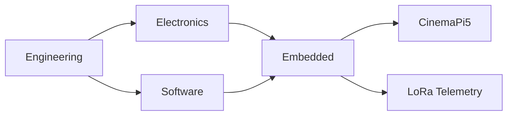

# ENGINEERING OS

<p align="center">
  <strong>Electronics · Embedded Systems · Software · Fabrication</strong>
</p>

<p align="center">
  <a href="#hardware">[ HARDWARE ]</a> •
  <a href="#embedded">[ EMBEDDED ]</a> •
  <a href="#software">[ SOFTWARE ]</a> •
  <a href="#projects">[ PROJECTS ]</a>
</p>

---

<details open>
<summary><code>visitor@github:~$ ls -la /workspace</code></summary>

| Directory | Description | Open |
|---|---|---|
| `/hardware` | Electronics & PCB | [ENTER](#hardware) |
| `/embedded` | Firmware & Sensors | [ENTER](#embedded) |
| `/software` | Systems & AI | [ENTER](#software) |
| `/projects` | Engineering evidence | [ENTER](#projects) |

</details>

---

<a id="embedded"></a>

## `~/skills/embedded`

```text
visitor@github:~$ cat embedded/info

Architecture:  ARM / RP2040
Interfaces:    SPI / I2C / UART / RS-485
Connectivity:  LoRa / Ethernet / TCP
OS:            Embedded Linux
```

<details>
<summary>▶ <code>inspect --project lora --verbose</code></summary>

### LONG-RANGE TELEMETRY

**Test result: 45 km validated**

| Property | Value |
|---|---|
| MCU | RP2040 |
| Radio | RFM95 868 MHz |
| Antenna | Directional Yagi |
| Sensors | IMU + GNSS |

<details>
<summary>▶ <code>cat validation.log</code></summary>

```diff
+ RADIO INITIALIZED
+ TELEMETRY LINK ESTABLISHED
+ LONG-RANGE TEST COMPLETED
+ RESULT: 45 KM VALIDATED
```

</details>

<details>
<summary>▶ <code>cat hardware/tree</code></summary>

```text
Telemetry System
├── TX
│   ├── RP2040
│   ├── RFM95
│   ├── IMU
│   └── GNSS
└── RX
    ├── RP2040
    ├── RFM95
    └── USB Host
```

</details>

</details>

<details>
<summary>▶ <code>inspect --project cinemapi5</code></summary>

### CINEMAPI5

Custom cinema camera based on Raspberry Pi 5.

| Layer | Implementation |
|---|---|
| Image Sensor | Sony IMX283 |
| Pipeline | Libcamera / PISP |
| Interface | Web UI / PWA |
| Features | RAW, LUTs, IMU, HUD |

[VIEW SOURCE](https://github.com/yassinebkr/cinematepi5)

</details>

[← Return to console](#engineering-os)

---

<a id="hardware"></a>

## `~/skills/hardware`

<details>
<summary>▶ <code>cat pcb_design.skills</code></summary>

- KiCad PCB design
- SPICE simulation
- Circuit debugging
- Reflow and soldering
- Digital and industrial interfaces

</details>

[← Return to console](#engineering-os)

---

<a id="software"></a>

## `~/skills/software`

<details>
<summary>▶ <code>ls /software</code></summary>

```text
python/
c-and-cpp/
linux/
networking/
ai-agents/
web-interfaces/
```

</details>

[← Return to console](#engineering-os)

---

<a id="projects"></a>

## `~/projects`

### System architecture



[← Return to console](#engineering-os)
